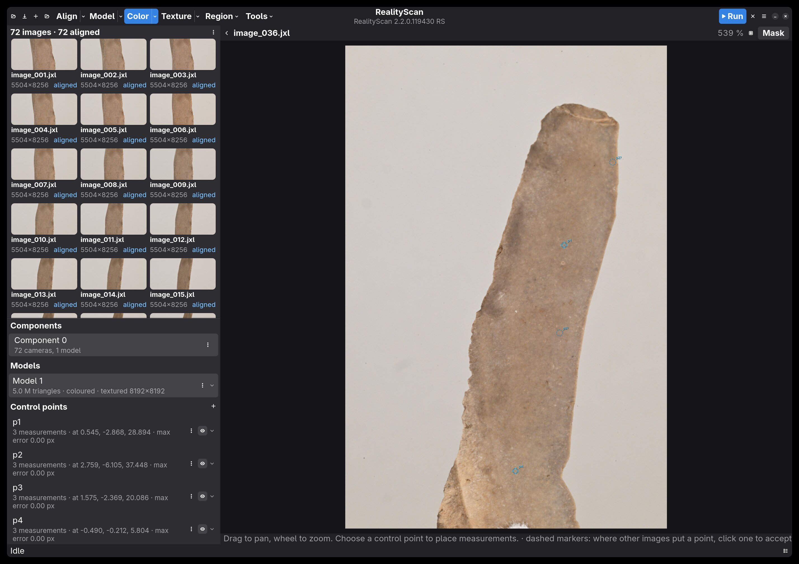
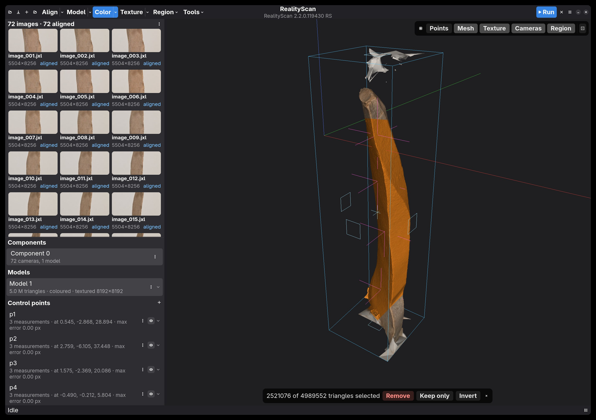

# RealityScan GTK

A native Linux desktop frontend for Epic's [RealityScan](https://www.realityscan.com/) photogrammetry
engine. 

Tryign to run RealityScan on linux works, but the UI has a whole bunch of issues, paritcularly around scaling and overlays. This is a front end that calls an installed RealityScan.

RealityScan still does all the processing, running headless under Wine; this app replaces
its Windows interface with a GTK4/libadwaita one and drives it through RealityScan's own Remote
Command plugin. Alignment, meshing, texturing, control points and scaling, masks, mesh clean-up
and export all run through RealityScan's engine, with a native window, drag-and-drop and a
hardware-accelerated 3D view.





Usable for real work (the screenshots are a 72 × 45 MP scan) but still early: expect rough
edges. [docs/usage.md](docs/usage.md) walks through the features, shortcuts and
troubleshooting; [PLAN.md](PLAN.md) has the architecture and what was learnt about
RealityScan's remote interface.

## Requirements

- **RealityScan 2.2** (free for personal use from Epic), installed in one of the two ways below.
- **An NVIDIA GPU with CUDA** for RealityScan's reconstruction and texturing.
- **GTK 4.18 and libadwaita 1.7** or newer (Fedora 42+, Arch, Debian 13, Ubuntu 25.04+), plus
  libepoxy, and **Rust 1.88+** to build.

## Setting up RealityScan

Both routes run the same Windows `RealityScan.exe`; the app finds whichever is installed and
lists both under its main menu if it finds both.

**Through Heroic Games Launcher (recommended):**

1. Install [Heroic](https://heroicgameslauncher.com/) and
   [umu-launcher](https://github.com/Open-Wine-Components/umu-launcher) (`umu-run` on your `PATH`).
2. Sign in to the Epic Games Store in Heroic and install **RealityScan**.
3. In the game's settings pick a Proton build (Proton-CachyOS and GE-Proton 11 are known to
   work) and add the environment variable `PROTON_NVIDIA_NVCUDA=1`. The app sets that variable
   itself for the instances it launches; RealityScan's own UI needs it too or it can't see the GPU.
4. Launch RealityScan from Heroic once, sign in to your Epic account and close it. That creates
   the Wine prefix and stores the login the headless instances reuse.

**Through Epic's Linux package:** `RealityScan-2.2.deb` is CrossOver 25 wrapped around the same
executable, so no Heroic or Proton is needed. Install it with `apt` (it lands in
`/opt/realityscan`), or on other distributions unpack it without root:

```bash
bsdtar -xOf RealityScan-2.2.deb data.tar.xz | bsdtar -xf - -C ~/.local/opt --strip-components=2 ./opt/realityscan
```

It also works inside a distrobox created with `--nvidia`. The package has no JPEG XL decoder;
when a Heroic install is present too, the app copies the decoder across on first launch. In our
tests this route ran alignment on the CPU, so it is not the faster one despite the name.

## Installing the app

```bash
# build dependencies: Arch
sudo pacman -S --needed rust gtk4 libadwaita libepoxy
# Fedora
sudo dnf install cargo gtk4-devel libadwaita-devel libepoxy-devel
# Debian 13 / Ubuntu 25.04+
sudo apt install cargo libgtk-4-dev libadwaita-1-dev libepoxy-dev
```

```bash
git clone https://github.com/pfalkingham/realityscan-gtk
cd realityscan-gtk
make install            # into ~/.local; PREFIX=/usr/local for system-wide
```

`make uninstall` removes it; Arch users can `cd packaging && makepkg -si` instead. To run from
the source tree use `cargo run --release` (the debug build is several times slower at decoding
thumbnails and loading large meshes).

## Using it

Start **RealityScan GTK** from your app menu, or `realityscan-gtk project.rsproj`. It starts a
headless RealityScan (5–10 s) and connects; the status bar and the log (Ctrl+L) show what is
happening. Then:

- Add images or folders (toolbar, Ctrl+I, or drop them on the window).
- Press **Run** (F9) for RealityScan's standard workflow: align, normal-detail model, texture.
  The pipeline buttons run the stages one at a time, with their settings under the arrows.
- Orbit the result in the 3D view, open a photo by double-clicking its thumbnail, place control
  points in photos or by Ctrl+clicking the model, paint masks, lasso and clean the mesh, and
  export (Ctrl+E) in the usual formats.

[docs/usage.md](docs/usage.md) has the full tour, the shortcuts, performance notes (including
GPU-accelerated AI masking) and troubleshooting.

## Development

`cargo build`, `cargo test` and `cargo clippy --all-targets` as usual; CI runs those on Fedora.
The workspace is five crates: `rs-client` (REST client and command builder), `rs-backend`
(finding, launching and stopping RealityScan), `rs-scene` (reading project state back, mesh and
region files), `rs-render` (OpenGL viewport) and `realityscan-gtk` (the app). Contributions are
welcome; PLAN.md is where findings about RealityScan's remote interface go.

## Legal

Not affiliated with or endorsed by Epic Games. RealityScan is Epic's software, installed and
licensed separately under its own terms; this repository contains no part of it. Licensed under
the [MIT License](LICENSE).
